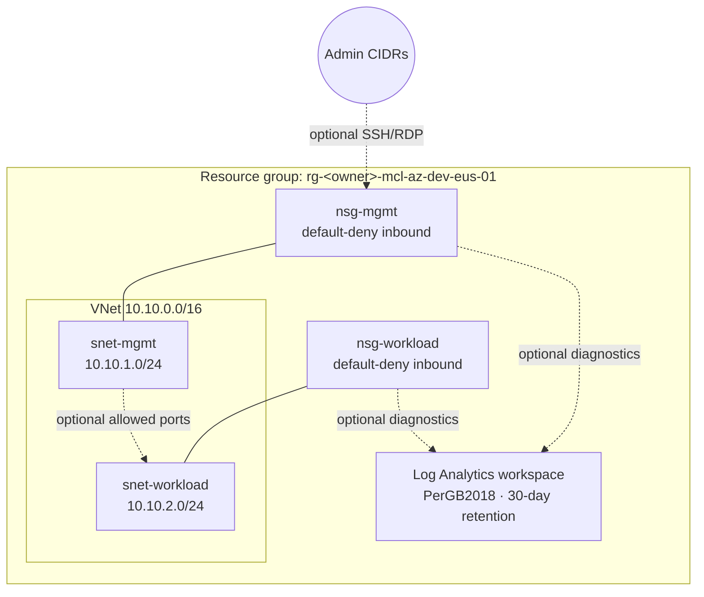

# Architecture (Azure)

Dotted lines are off by default.

## Layout

| Path | Owns |
|---|---|
| `envs/dev` (root) | Naming inputs, shared tags, resource group, module wiring |
| `modules/logging` | Log Analytics workspace |
| `modules/networking` | VNet, subnets, NSGs, NSG associations, NSG diagnostics |

## Security Toggles

All of these are variables in `envs/dev/variables.tf`, and all are off or empty by default.

| Variable | Effect |
|---|---|
| `admin_source_cidrs` | Source ranges allowed for management access |
| `enable_management_ssh` | Allow TCP 22 into mgmt from `admin_source_cidrs` |
| `enable_management_rdp` | Allow TCP 3389 into mgmt from `admin_source_cidrs` |
| `enable_workload_allow_from_mgmt` | Allow `workload_allowed_ports` from the mgmt subnet into workload |
| `workload_allowed_ports` | Ports opened by the setting above (default `["22"]`) |
| `enable_nsg_diagnostics` | Send NSG event and rule-counter logs to Log Analytics |

## Not Yet Implemented

- **NSG flow logs:** need Network Watcher plus a storage account module
- **RBAC model, budgets, CI checks:** see the roadmap in the main README
